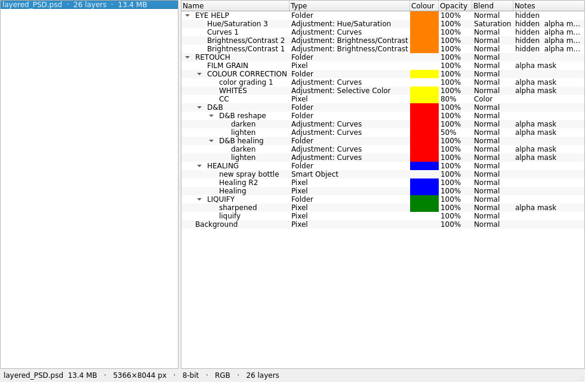
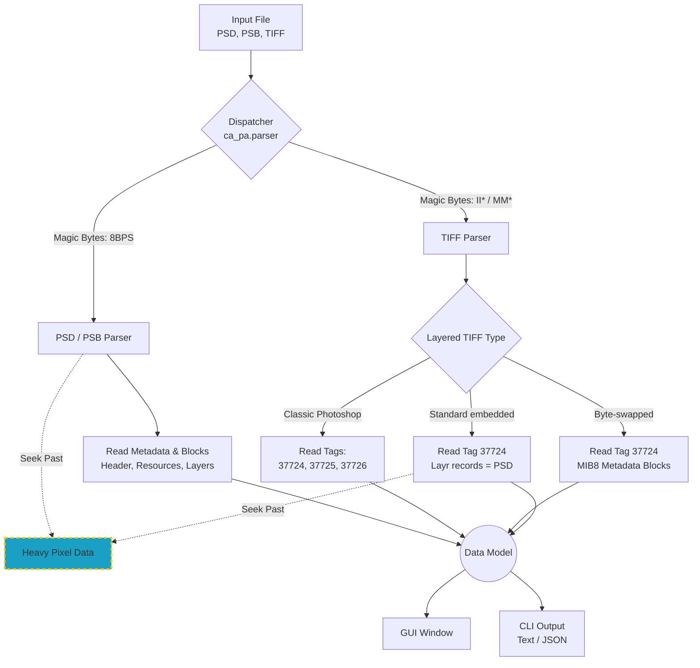
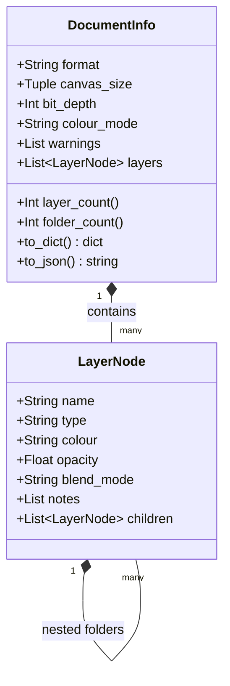
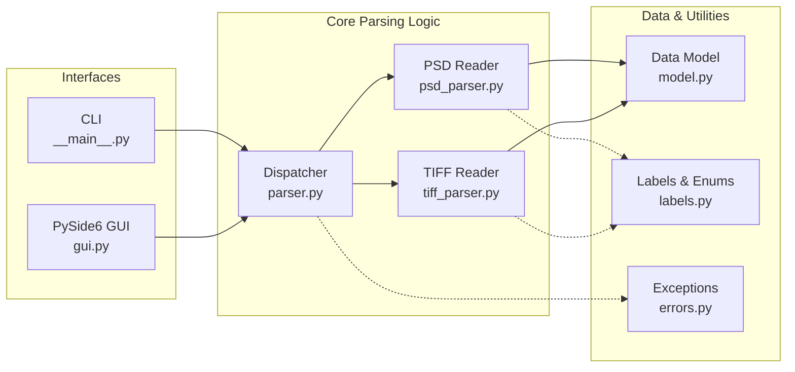

<p align="center"></p>

<h1 align="center"><i>ca-pa</i></h1>

_**ca-pa**_ is a layer inspector, a small macOS utility that opens big layered image files,
**layered TIFF**, **PSD** and **PSB**, and shows the **layer structure**:
the tree of folders, pixel layers, shapes, text, smart objects and adjustment
layers, with each layer's metadata. It does this **without decoding a single
pixel**, so a multi-hundred-MB file with 30+ layers opens in a couple of
seconds and uses a few tens of megabytes of RAM.

<p align="center"></p>
The name is a nod to *capas* (Spanish for “layers”).

---

## Why

Full-featured editors load an image's pixels to show its layers. For a 1–2 GB
layered TIFF or PSD that means gigabytes of RAM and a long wait, even when you
only want to *see* what's in the file. ca-pa reads just the metadata — the
header and the per-layer records — and steps straight over the pixel data, so
it stays fast and light no matter how big or deep the file is.

Think of it as a “layer inspector” / file peeker: you open a file, glance at
its structure and metadata, and move on, without a heavyweight editor.

## What it shows

For every **layer** (and folder):

| Column | Contents |
| ------ | -------- |
| **Name** | The layer's name. The cell background is painted with the layer's colour. |
| **Type** | Pixel, Shape, Text, Smart Object, Folder, or Adjustment (with the adjustment kind, e.g. *Curves*). |
| **Opacity** | 0–100 % (values under 100 % are the ones worth noticing). |
| **Blend** | The blend mode (Normal, Multiply, Screen, Overlay, …). |
| **Notes** | Flags: hidden, vector mask, alpha mask, and the layer effects (drop shadow, bevel, glow, …). |

For every **document**: format, canvas size, bit depth, colour mode, the
**layer** and **folder** counts (folders are containers, never counted as
layers), plus any warnings (e.g. that a non-standard byte-swapped layer block was decoded, or that the file is flattened).

Files that carry **no layer information** (flattened exports) are detected and
shown as a single merged layer with a note, rather than failing.

Several files can be open at once, listed in the sidebar.  Each row has an
✕ button that closes just that file; the **Close** toolbar button (or the
Delete key) closes the selected one and **Close all** empties the window.
The app opens with a short splash — the icon on white with the name *ca-pa:
a layer inspector*.

## How it works



* **PSD / PSB** — the reader walks the file header, image resources and layer
  records, and **seeks past** the channel image data and the merged image. The
  per-layer tagged blocks (names, colours, masks, effects, section dividers)
  are small, so only those are read.
* **Layered TIFF** — reads the classic Photoshop triple: `37724` (layer state:
  bounds/opacity/blend), `37725` (names) and `37726` (additional layer info:
  colours, effects, folder dividers).
* **Byte-swapped TIFF** — some exporters stash a *whole byte-swapped copy of
  the PSD layer section* inside TIFF tag `37724`: a run of `MIB8` blocks whose
  multi-byte integers are little-endian and whose four-character tag/blend keys
  are stored reversed (`norm`→`mron`, `colr`→`rloc`, `Layr`→`ryaL`, …), while
  names and tagged-block payloads keep their natural order. ca-pa detects that
  shape, forward-decodes the record stream and normalises each record back to
  standard PSD form — recovering **every** field a normal PSD keeps (names,
  nesting, kind, colour, visibility, opacity, blend mode, alpha/vector masks and
  effects) so the result matches the equivalent PSD exactly — then seeks straight
  over the large image-data blocks, keeping even a +1 GB file at a few
  megabytes. An informative warning notes the non-standard block.

* **Standard embedded TIFF** — other writers put a normal, *non-swapped* "Adobe
  Photoshop Document Data Block" (ordinary `8BIM` resources, including a `Layr`
  block) in the same `37724` tag. Its layer records are **byte-identical to a
  PSD's**, so ca-pa reuses the exact PSD record reader and reproduces the file
  perfectly — names, nesting, kinds, colours, visibility, opacity, blends, masks
  and effects all match the equivalent PSD. The multi-hundred-MB trailing image
  data is still only sought over, never read. This is the format of the
  `sample2.tif` reference file.
* **Dispatch** — `ca_pa.parser.parse_file()` picks the reader by extension and,
  more reliably, by magic bytes (`8BPS` for PSD/PSB, `II*\0`/`MM\0*` for
  TIFF), so a mis-named file still opens correctly. A file that can't be read
  raises `ca_pa.errors.ParseError` with a useful message.

The data model is two plain dataclasses — `DocumentInfo` (canvas + layer tree)
and `LayerNode` (one layer) — with `to_dict()`/`to_json()` for scripting.




---

## Getting the app

The easiest way is a prebuilt bundle from the
[releases](https://github.com/cuarentaysiete/ca-pa/releases) page — pick the
zip for your chip, unzip it, and you have `ca-pa.app`:

| Your Mac has… | Download |
|---|---|
| Apple Silicon (M1/M2/M3/M4, 2020+) | `ca-pa-macos-arm64.zip` |
| Intel | `ca-pa-macos-intel.zip` (also runs on Apple Silicon via Rosetta 2) |

<details>
<summary><b>Building from source</b> (macOS only)</summary>

```bash
git clone https://github.com/cuarentaysiete/ca-pa
cd ca-pa
python3 -m venv .venv
.venv/bin/pip install -e ".[app]"          # app + PySide6 + psd-tools + pyinstaller
.venv/bin/pyinstaller --clean --noconfirm ca-pa.spec
open dist/ca-pa.app
```

Because PyInstaller does not build across platforms, the `.app` must be built
on macOS. See [`docs/packaging.md`](docs/packaging.md) for the full guide,
including the optional high-resolution icon and code signing.
</details>

## Using it

**The window** — drop `.tif` / `.tiff` / `.psd` / `.psb` files anywhere on the
window (several at once). Each becomes an entry in the left list; selecting one
shows its layer tree on the right. The status bar summarises the document and
any warnings. Folders open and close with the tree's disclosure triangles.

**The command line** — for scripting, without the window:

```bash
ca-pa                          # open the window
ca-pa a.tiff b.psd             # open the window with those files loaded
ca-pa --text a.tiff            # print the layer tree as indented text
ca-pa --json a.tiff            # print the structure as JSON
```

`--json` emits the full `DocumentInfo` (canvas, warnings, and the nested layer
tree with every field above), which is handy for feeding other tools.

## Supported files

| Format | Notes |
| ------ | ----- |
| PSD | 8-bit and 16-bit, any colour mode. |
| PSB | Big PSD (files > 300 MB / > 30 000 px). |
| Layered TIFF | The classic Photoshop `37724`/`37725`/`37726` triple (little- or big-endian). |
| TIFF (byte-swapped) | The non-standard, byte-swapped embedded-PSD variant some tools write. |
| TIFF (standard embedded) | A normal `8BIM` `Layr` block in `37724`; layer metadata matches the PSD exactly. |
| Flat TIFF / PSD | Detected; shown as one merged layer with a note. |

## Project layout



```
src/ca_pa/
    __main__.py     CLI + GUI entry point (python -m ca_pa)
    run_app.py      single frozen entry point for the PyInstaller bundle
    parser.py       dispatch by extension + magic bytes
    psd_parser.py   PSD/PSB reader (metadata only, seeks past pixels)
    tiff_parser.py  layered-TIFF reader (classic triple + embedded MIB8/standard block)
    model.py        DocumentInfo / LayerNode dataclasses
    labels.py       blend modes, sheet colours, adjustments, effect names
    errors.py       ParseError
    gui.py          the PySide6 window (toolbar, sidebar, tree, status, splash)
    resources/      the app icon (PNG + .icns)
tests/
    make_samples.py synthesises PSD/TIFF files with known metadata
    test_parser.py  parser + memory-bound tests
    test_gui.py     GUI smoke tests (offscreen)
ca-pa.spec          PyInstaller specification (-> ca-pa.app)
.github/workflows/  CI: build + release on macOS
```

## Development

```bash
python3 -m venv .venv
.venv/bin/pip install -e ".[dev]"

.venv/bin/python -m pytest            # the whole suite
.venv/bin/python -m ca_pa --text file.psd
```

The suite generates its own sample files (PSD, layered TIFF, flat, and a large
incompressible one for the memory-bound test) into a temp directory, so it runs
anywhere with no fixtures. Real-world reference files are **not** committed
(they are 10–140 MB); to include them in a run, point the suite at a folder:

```bash
CA_PA_SAMPLES=/ruta/samples .venv/bin/python -m pytest
```

## Packaging & CI

A GitHub Actions workflow (`.github/workflows/build.yml`) runs the test
suite once, then **builds `ca-pa.app` with PyInstaller** on an Apple
Silicon runner (`macos-latest`) — because PyInstaller is not
cross-platform, the macOS app must be assembled on macOS.  The build
matrix has two legs on that same runner: **arm64** (native) and
**x86_64** (Intel, under Rosetta 2; that leg installs a pinned
python-build-standalone interpreter, since the runner images no longer
ship an `x86_64` Python the `setup-python` action will resolve).
Pushing a `v*` tag then publishes a single GitHub Release with both
zips.  Manual runs are available from the *Actions* tab and keep their
builds as run artifacts.


## License

See [LICENSE](LICENSE).
